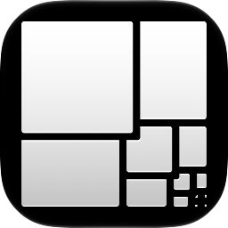
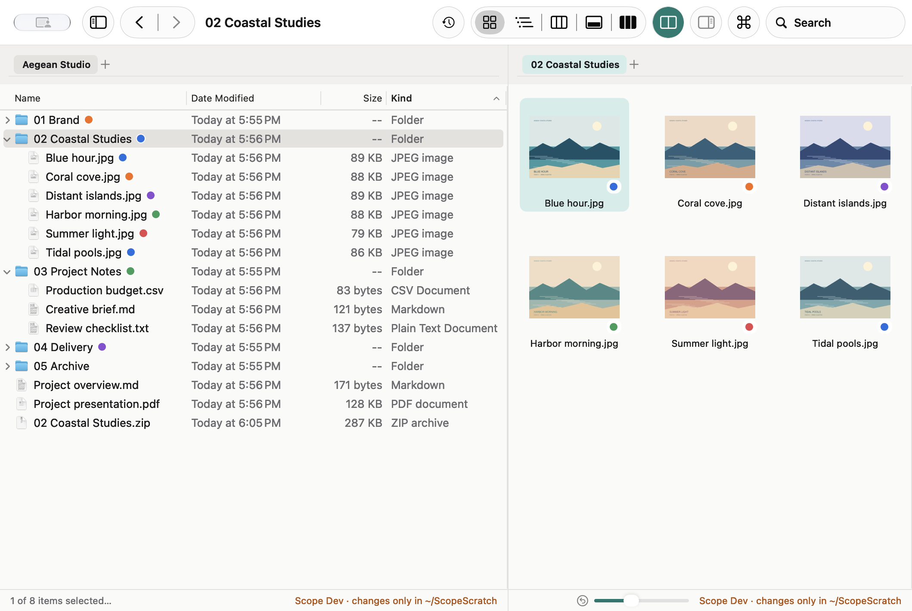
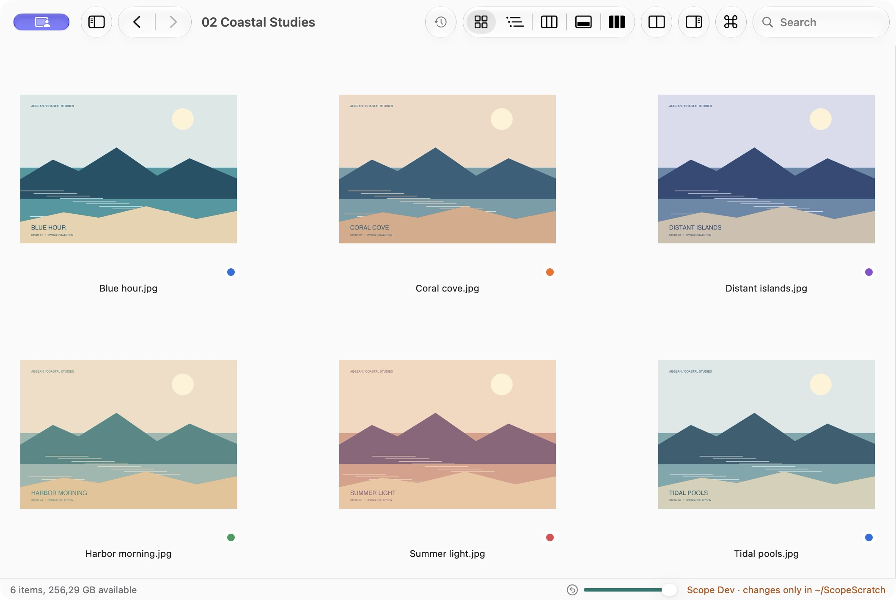
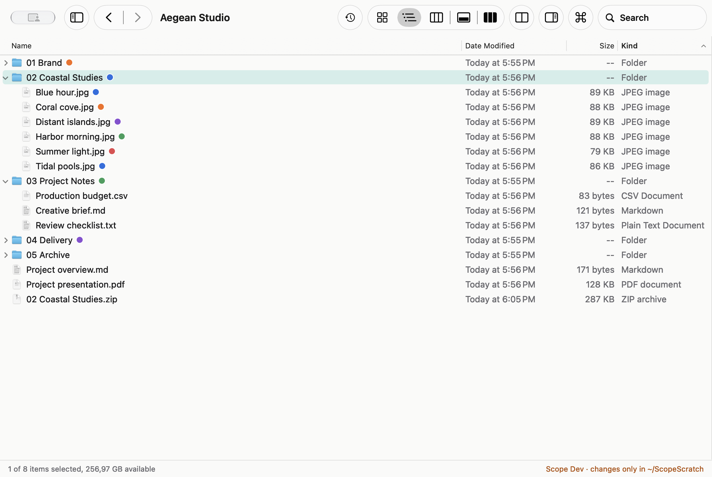
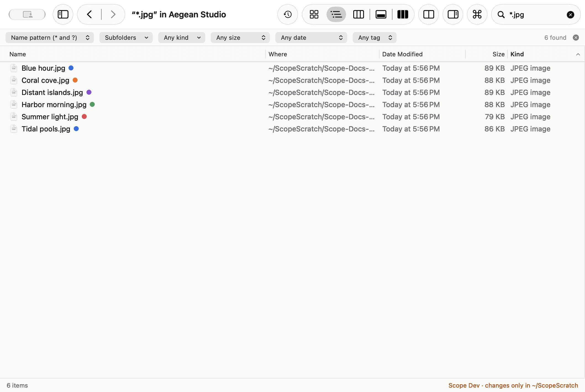
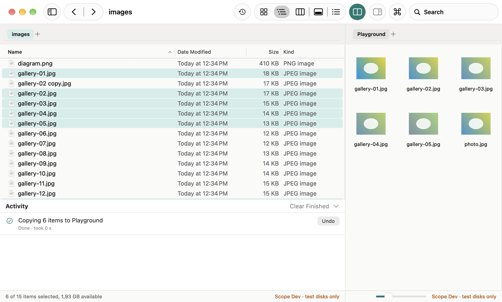

<p align="center">
  
</p>

<h1 align="center">Scope</h1>

<p align="center">
  <strong>A fast, careful file manager for macOS that sits beside Finder.</strong><br>
  Tabs, dual panes, every classic view, a real operations queue, and a search that works.
</p>

<p align="center">
  <a href="https://github.com/antonisPanos/scope/actions/workflows/ci.yml"></a>
  <a href="https://github.com/antonisPanos/scope/releases/latest"></a>
  
  
</p>

<p align="center">
<picture>
  <source media="(prefers-color-scheme: dark)" srcset="docs/images/split-view-dark.png">
  
</picture>
</p>

---

## Why Scope

Finder is fine for opening a file. For moving thousands of them, comparing two folders,
or finding something three levels down, it gets in the way. Scope is built for that work,
uses Finder's keyboard shortcuts, and is careful with your files.

## Features

**Browse your way**
- Five views: Icons, Details, Columns, Gallery and List (Cmd+1 to Cmd+5). The selection carries over when you switch.
- Tabs on every window, and a sidebar with Favorites, Recents, Tags, volumes and mounted disk images.
- A path bar you can click or type into. Cmd+K opens a command palette that finds any command or place.
- A preview pane with Quick Look and the details that matter: dimensions, camera, duration, item count.
- An icon grid that reflows to the window, sized with a slider, Cmd+= / Cmd+-, or a pinch.

**Two folders side by side**
- Split view (Shift+Cmd+S) with its own tabs on each side.
- Copy or Move to Other Side (Ctrl+Cmd+C / Ctrl+Cmd+M), or drag between the panes.

**Operations you can trust**
- Copy, move, duplicate, rename, compress, extract, mount and eject disk images, all with Undo, even for a cancelled job.
- An activity drawer that shows every job's progress, speed and time left, plus Pause, Cancel and a queue you can reorder.
- When a name is taken, you choose: Keep Both, Replace, Skip or Stop, with "Apply to all".

**Search that finds things**
- Searches the folder you're in and its subfolders by name, glob pattern (`IMG_2026*`) or regular expression.
- Filters for hidden files, packages, kind, size, date and tag. Results stream in as they're found.
- "Contents (Spotlight)" searches inside files.

The [user guide](docs/USER_GUIDE.md) covers every feature and shortcut.

## A closer look

| | |
| --- | --- |
| <picture>   <source media="(prefers-color-scheme: dark)" srcset="docs/images/browser-icons-dark.png">    </picture> | <picture>   <source media="(prefers-color-scheme: dark)" srcset="docs/images/details-dark.png">    </picture> |
| **Icons**: thumbnails in a grid that reflows to the window | **Details**: sortable, resizable columns |
| <picture>   <source media="(prefers-color-scheme: dark)" srcset="docs/images/search-dark.png">    </picture> | <picture>   <source media="(prefers-color-scheme: dark)" srcset="docs/images/activity-dark.png">    </picture> |
| **Search**: names, patterns or regular expressions, with filters | **Activity**: every job with progress, speed, pause, cancel and undo |

Screenshots are taken from Scope Dev.

## Built to never lose a file

- **Nothing is overwritten.** Copies are written under a hidden name and renamed into place only when they're complete.
- **Deletes go to the Trash**, always. Replace sends the old item to the Trash too.
- **Moves between disks are verified.** Each file's SHA-256 is checked before the original is trashed.
- **Archives can't escape.** Entries with `../`, absolute paths or links that point outside are skipped.
- **The main thread never touches the disk**, so a slow network share can't freeze the window, and Cancel never hangs.

## Install

Download the DMG from the [latest release](https://github.com/antonisPanos/scope/releases/latest),
open it, and drag Scope to Applications. Scope needs macOS 27.2 or later.

> Releases aren't notarized yet. The first time you open Scope, right-click it and choose Open.

Scope is in early development (0.x). Release builds are read-only for now: they browse,
preview and search, but they won't change files until the write path has had more testing.

## Build from source

You need macOS 27.2 and Xcode 27.

```sh
git clone https://github.com/antonisPanos/scope.git && cd scope
make setup      # git hooks, and Config/Local.xcconfig for your signing team
make build      # builds "Scope Dev", which changes files only in ~/ScopeScratch
make test       # engine tests
```

Run `make` to see every task. [CONTRIBUTING.md](CONTRIBUTING.md) covers the workflow and
[docs/ARCHITECTURE.md](docs/ARCHITECTURE.md) explains how the code fits together.

## Project

- [Changelog](CHANGELOG.md)
- [Releasing](docs/RELEASING.md)
- [Report a bug or suggest a feature](https://github.com/antonisPanos/scope/issues/new/choose)
