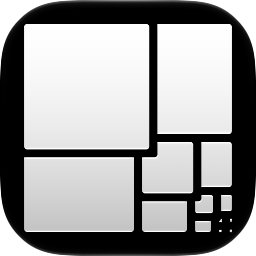
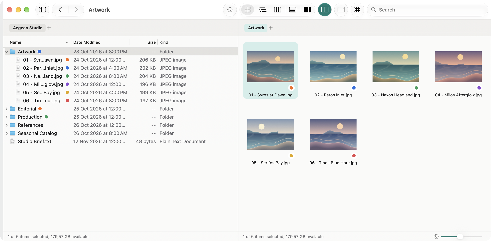
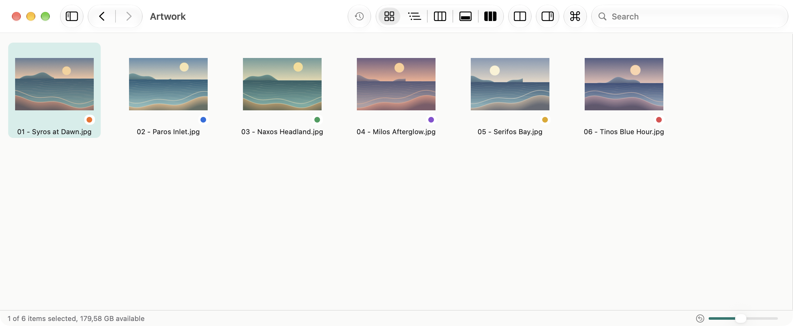
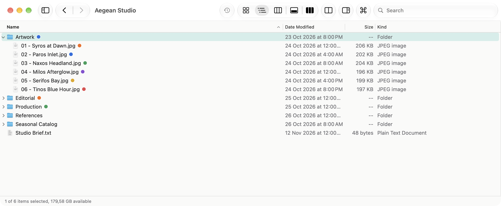
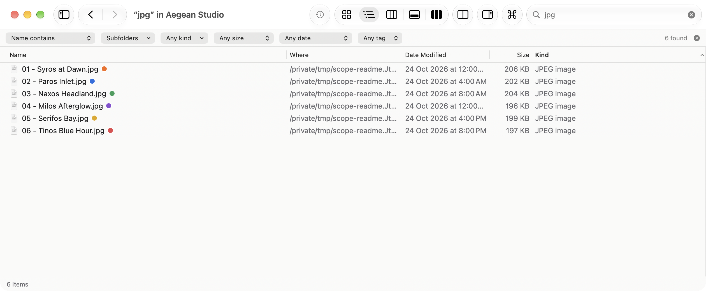
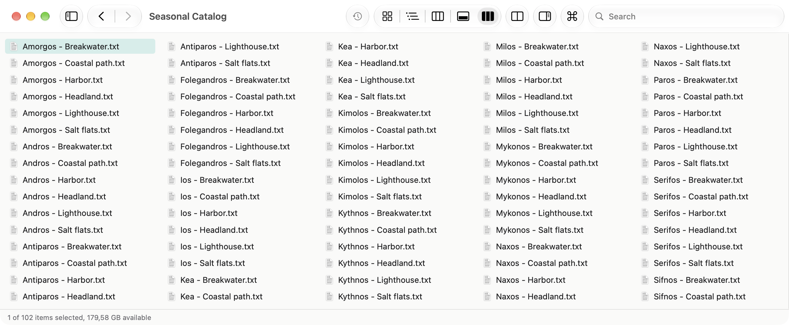

<p align="center">
  
</p>

<h1 align="center">Scope</h1>

<p align="center">
  <strong>A native file manager for macOS, built to sit beside Finder.</strong><br>
  Five views, tabs, dual panes, streaming search and a file operations queue.
</p>

<p align="center">
  <a href="https://github.com/antonisPanos/scope/actions/workflows/ci.yml"></a>
  <a href="https://github.com/antonisPanos/scope/releases/latest"></a>
  
  
</p>

<p align="center">
<picture>
  <source media="(prefers-color-scheme: dark)" srcset="docs/images/split-view-dark.png">
  
</picture>
</p>

## Browse, compare and organize

- **Five views:** Icons, Details, Columns, Gallery and List (`Cmd+1` through `Cmd+5`).
  List fills compact columns from top to bottom and scrolls horizontally;
  Details supports sortable columns and expandable folders. Scope can remember
  the view type and icon size for each folder.
- **Tabs and dual panes:** keep places open, compare two folders, and copy or move
  the selection to the other side (`Ctrl+Cmd+C` / `Ctrl+Cmd+M`).
- **Finder color tags:** see tags on folders, thumbnails and filenames; apply them
  from the context menu. Metadata changes refresh without losing your place.
- **Preview and navigation:** Quick Look, a details pane, Get Info with folder size
  and item counts, an editable path bar, Back/Forward history and a command palette
  (`Cmd+K`).
- **Search:** stream results from the current folder and its subfolders using a
  name, glob or regular expression. Filter by kind, size, modification date and
  tag, or use Contents (Spotlight) for indexed file contents.
- **File operations:** copy, move, duplicate, rename, create folders, compress to ZIP,
  extract archives, and mount or eject disk images. The activity drawer shows job
  status, progress, pause/cancel controls and queued work. Undo is available for
  supported file changes, including completed steps of a cancelled job.

The [user guide](docs/USER_GUIDE.md) covers the views, shortcuts, settings and operation limits.

## A closer look

| | |
| --- | --- |
| <picture><source media="(prefers-color-scheme: dark)" srcset="docs/images/browser-icons-dark.png"></picture> | <picture><source media="(prefers-color-scheme: dark)" srcset="docs/images/details-dark.png"></picture> |
| **Icons:** resizable thumbnails and color tags | **Details:** sortable metadata and expandable folders |
| <picture><source media="(prefers-color-scheme: dark)" srcset="docs/images/search-dark.png"></picture> | <picture><source media="(prefers-color-scheme: dark)" srcset="docs/images/compact-list-dark.png"></picture> |
| **Search:** results and filters across subfolders | **List:** compact columns with horizontal scrolling |

The [user guide](docs/USER_GUIDE.md#views-and-preview) also shows Gallery and
Columns. The README screenshots show the installed production release with a
fictional demo project. See the [screenshot provenance](docs/images/README.md).

## Care with your files

- Copies are staged under hidden `.scope-partial-` names and published when complete.
  Replace puts the previous item in the Trash rather than overwriting its contents.
- Moves between disks verify file contents with SHA-256 before trashing the originals.
- **Move to Trash** uses the Trash when available. A disk without Trash requires
  confirmation before permanent deletion. **Delete Immediately** (`Option+Cmd+Delete`)
  also requires confirmation for each disk, naming every item. Permanent deletion has no Undo.
- Archive extraction rejects unsafe paths and links. Archive codecs run in a separate
  sandboxed service; the engine validates entries and controls file access.
- File I/O runs off the main thread. Jobs support cancellation and clean up unfinished copies.

## Install

Download the DMG from the [latest release](https://github.com/antonisPanos/scope/releases/latest),
open it, and drag **Scope** to **Applications**. The app requires **macOS 27.2 or later**.

The current installer is **Developer ID signed and notarized**. Download its
matching `.dmg.sha256` file if you want to verify the DMG.

```sh
# In the folder containing both downloaded files; substitute your version.
shasum -a 256 -c Scope-0.8.0.dmg.sha256
```

Scope uses normal macOS permissions for file operations. Scope Dev restricts file
changes to `~/ScopeScratch`. An explicit [stress launch](docs/STRESS_TESTING.md)
confines managed file access to a disposable two-volume disk image.

## Build from source

Use **macOS 27.2+** and **Xcode 27.2** (or a compatible newer Xcode) with the
**macOS 27.2 SDK or newer**. Local ad-hoc builds do not require a paid Apple account.

```sh
git clone https://github.com/antonisPanos/scope.git
cd scope
make hooks
make build      # Scope Dev; changes files only inside ~/ScopeScratch
make test       # standalone engine tests, one suite at a time
make app-test   # app tests hosted in Scope Dev
open "build/DerivedData/Build/Products/Debug/Scope Dev.app"
```

Without `Config/Local.xcconfig`, builds sign ad hoc. `make setup` additionally creates
that optional file for Apple Development signing; replace its `YOURTEAMID` placeholder
before building. See [Contributing](CONTRIBUTING.md) for signing overrides and workflow.
Run `make` for all tasks, including `make install-dev` and local DMG packaging.

## Project

- [User guide](docs/USER_GUIDE.md)
- [Architecture and safety boundaries](docs/ARCHITECTURE.md)
- [Project instructions for agents](AGENTS.md)
- [Changelog](CHANGELOG.md)
- [Release process](docs/RELEASING.md)
- [Report a bug or suggest a feature](https://github.com/antonisPanos/scope/issues/new/choose)
