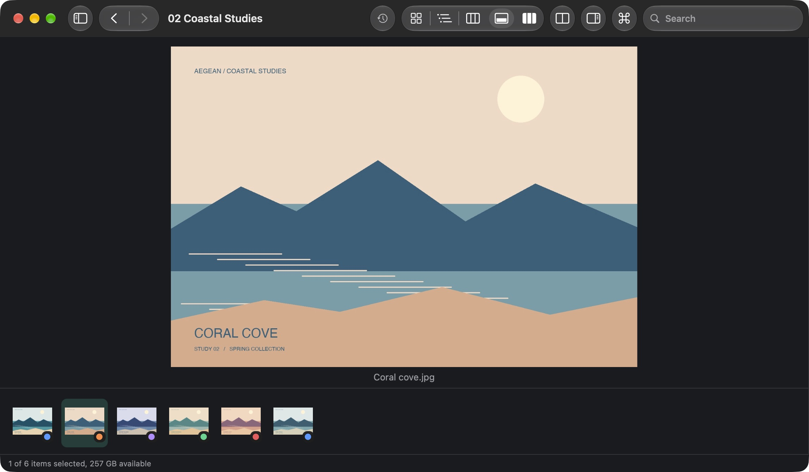
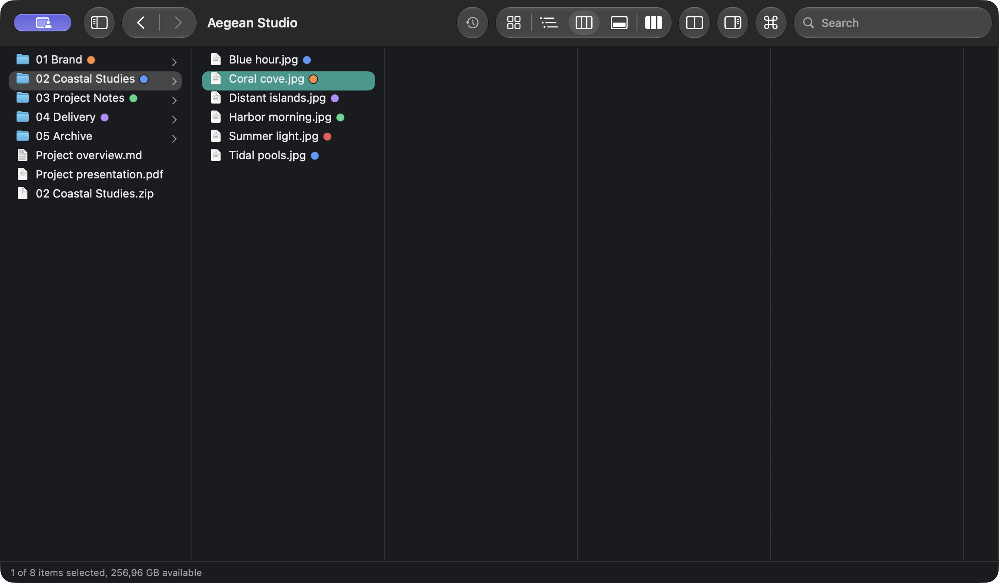
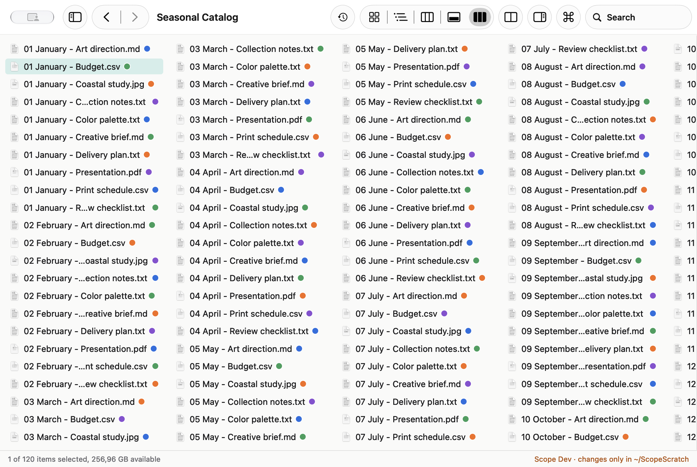

# Scope user guide

Scope follows Finder shortcuts where possible. This guide describes the merged
app; the [release and source-version note](../README.md#install) distinguishes
`main` from the current installer.

## Windows, tabs and navigation

- `Cmd+N` opens a window; `Cmd+T` opens a tab and `Cmd+W` closes the current tab.
  Outside split view, tabs use the native macOS window tab bar.
- The sidebar contains Favorites, Recents, standard home folders, Locations,
  mounted disk images with Eject controls, and Tags. Add a folder with `Ctrl+Cmd+T`.
  Recents and Tags use Spotlight across the computer, rather than only the current folder.
- Click a path-bar segment to go there. `Cmd+L` or `Shift+Cmd+G` lets you type an
  absolute or relative path, including `~`. `Option+Cmd+P` toggles the path bar.
- `Cmd+[` / `Cmd+]` go Back/Forward; `Cmd+Up` opens the enclosing folder;
  `Cmd+Down` opens the selection. History belongs to the active tab. The toolbar
  validation fix in [#139](https://github.com/antonisPanos/scope/pull/139) is merged
  after v0.3.0, alongside the List redesign for the v0.4.0 release.
- `Cmd+K` opens the command palette for commands, places and typed paths.
- `Shift+Cmd+.` toggles hidden files. `Ctrl+Option+Cmd+1` through `7` choose sort keys.
  `Shift+Cmd+H/D/O/A/F` open Home/Desktop/Documents/Applications/Recents;
  `Option+Cmd+L` opens Downloads; `Cmd+E` ejects a selected volume or image.
- Visible folders update when their contents change. Scope follows light/dark appearance.

Scope Dev reads anywhere but changes files only inside `~/ScopeScratch`. **Go >
Scratch Folder** creates and opens that folder. The status bar identifies the development guard.
For the separate image-only stress launch, see [Stress testing](STRESS_TESTING.md).

## Views and preview

| View | Shortcut | Behavior |
| --- | --- | --- |
| Icons | `Cmd+1` | A grid of Quick Look thumbnails; reflows with the window |
| Details | `Cmd+2` | Sortable, resizable metadata columns and folders that expand in place |
| Columns | `Cmd+3` | One column per folder level for navigating a hierarchy |
| Gallery | `Cmd+4` | A large preview above a thumbnail strip |
| List | `Cmd+5` | Compact columns filled top-to-bottom, with horizontal scrolling |

Selection carries over when switching views. In Details, use the header menu to
show/hide columns, and drag headers to reorder or resize them. Size the Icons grid
with the status-bar slider, `Cmd+=` / `Cmd+-`, or a pinch. The thumbnail memory cache
is capped at 64 MB; Scope keeps no thumbnail disk cache.

Finder color tags appear on folder icons and thumbnails in Icons/Gallery, and
beside filenames in the other views. Context-menu tag controls apply/remove tags
on the selection. Changes refresh without losing selection or open columns.
Tag changes currently have no Undo.

`Shift+Cmd+P` toggles the details pane with Quick Look plus size, dates, last opened,
tags, location, image dimensions/camera, media duration or folder item count.
`Space` or `Cmd+Y` opens Quick Look; arrow keys in the panel move the selection.

| Gallery | Columns | List |
| --- | --- | --- |
|  |  |  |

List uses compact columns, supports horizontal scrolling with a normal mouse
wheel, and reflows as the window height changes. Its three-filled-column icon is
distinct from Columns' folder-hierarchy icon. Keyboard navigation, type-to-select,
multiple selection and filename tooltips work across the columns.
[PR #140](https://github.com/antonisPanos/scope/pull/140) merged on 3 November 2026
after v0.3.0, for the v0.4.0 release. The v0.3.0 installer uses the
previous vertical List.

## File operations

- Copy `Cmd+C`, Paste `Cmd+V`, Move Item Here `Option+Cmd+V`, Duplicate `Cmd+D`,
  Rename `Return`, New Folder `Shift+Cmd+N`, Move to Trash `Cmd+Delete`, Copy Path
  `Option+Cmd+C`, Get Info `Cmd+I`, and Print `Cmd+P` for supported selections.
- The context menu also offers Open With, tags, Compress (ZIP), Extract,
  Mount Disk Image, Mount Read-Only and Eject. Archive recognition includes ZIP,
  TAR and common compressed variants, 7z and RAR; decoding depends on macOS libarchive.
- Drag and drop moves on the same disk and copies across disks or with Option held.
- `Cmd+Z` undoes supported changes: copies, moves, duplicates, renames, new folders,
  Trash, compression and extraction. Completed reversible steps remain undoable
  after cancellation or failure. Permanent deletion, tag edits, mounting and ejecting
  are not undoable. Undo may ask before removing a created file edited since the job.
- Conflicts offer **Keep Both**, **Replace**, **Replace If Older**, **Skip** or **Stop**,
  with **Apply to all**. Replace puts the existing item in the Trash. Item failures
  offer **Try Again**, **Skip** or **Stop**.
- The activity drawer (`Option+Cmd+A` or the toolbar clock) shows status, progress,
  elapsed/remaining time and speed when available, plus Pause, Cancel, queued work
  with Start Now/reordering, and Undo when supported. The Dock shows progress.
  Jobs sharing a disk run one at a time and busy items cannot be changed by another job.

### Trash and permanent deletion

Move to Trash normally uses the Trash without a confirmation dialog. On a disk
without Trash, Scope asks before deleting permanently, naming the disk and all
items. Cancel is the default. Items on other disks still use their Trash.

**Delete Immediately** (`Option+Cmd+Delete`) skips the Trash after a separate
confirmation for each disk, naming every item, with Cancel as default and no
Apply to all. The list scrolls and shows each item's folder, so items with the
same name can be told apart. Permanent deletion cannot be undone. Neither form bypasses Scope
Dev's scratch restriction or macOS permissions.

Copies use hidden partial names and publish only when complete. Cross-disk moves
verify each file's SHA-256 before trashing the original. Unsafe archive paths and
links are skipped rather than allowed to escape the extraction folder.

### Archive metadata

Archives preserve resource forks, FinderInfo, tags, ordinary extended attributes,
permissions and modification dates using bounded AppleDouble records. ZIPs
interoperate with Finder/ditto; other tools may expose `__MACOSX` or `._` sidecars.
Metadata is limited to 64 MB per item; exceeding it fails without publishing an
archive. Compression refuses custom ACLs or file flags it cannot preserve.
Ownership and creation dates are not retained. Download quarantine comes from the
archive's provenance, rather than untrusted stored metadata; repacking a quarantined
file also marks the resulting archive as quarantined.

## Split view and search

`Shift+Cmd+S`, the toolbar button or **Open in Split View** on a folder opens two
panes. Each has its own tabs. `Cmd+T` adds a tab on the focused side; `Cmd+W` closes
it. Click a pane or use `Option+Cmd+Left/Right` to focus it. Copy to Other Side is
`Ctrl+Cmd+C`; Move to Other Side is `Ctrl+Cmd+M`. Dragging between panes also works.
The details pane and path bar hide while split is active; `Cmd+L` opens the command
palette with the current path for editing.

`Cmd+F` or the toolbar search field searches the current folder. **Name contains**,
**Name pattern (glob)** (`*.pdf`, `IMG_2026*`) and **Regular expression** use Scope's
crawler. The filter bar controls hidden files, subfolders (on by default), package
contents, kind, size, modification date and tag. Results arrive as they are found;
Stop or Escape cancels the search. The Where column gives each result's folder.
**Contents (Spotlight)** searches indexed contents and is limited by Spotlight's
coverage and permissions.

## Shortcut preferences

In **Scope > Settings > Shortcuts**, Return can open instead of rename, F2 can
rename, F5 can reload, `Cmd+X` can cut files for a moving paste, and Option+Left/Right
can navigate history. Delete alone can do nothing, go Back or move to Trash.
Defaults enable F2, F5 and `Cmd+X`; Return renames and Delete alone does nothing.
Settings also control system notifications for completed, failed or waiting jobs.
